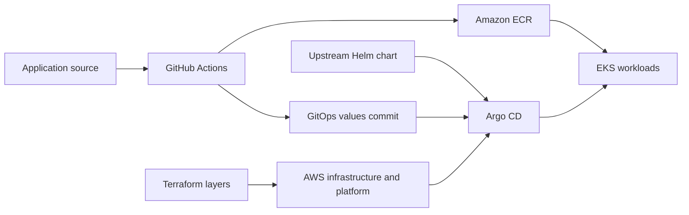

# otel-demo-infra-aws

An AWS platform engineering project that provisions infrastructure with **Terraform** and delivers the upstream **[OpenTelemetry Demo](https://opentelemetry.io/docs/demo/)** through **Helm, Argo CD, GitHub Actions, and Amazon ECR**.

This repository owns AWS provisioning, platform services, and Argo CD
Application registration.

Application source ([otel-demo-apps](https://github.com/lackito/otel-demo-apps)) and Kubernetes desired state ([otel-demo-gitops-aws](https://github.com/lackito/otel-demo-gitops-aws)) live
in separate repositories.

_\*Commands in documentation assume you are authenticated to the intended AWS account with the required permissions._

## How it works



- Terraform manages the infrastructure, platform, ECR repositories, publisher roles, and Application registration.
- Ad, Product Catalog, and Recommendation each have an independent release
workflow and ECR publisher role.
- CI publishes images and updates GitOps values.
- Argo CD deploys the workloads.

## Start here

| Goal | Guide |
| --- | --- |
| Build, verify, access, or destroy the environment | [Operations](docs/OPERATIONS.md) |
| Understand ownership and delivery | [Architecture](docs/ARCHITECTURE.md) |
| Create the network and EKS | [02: Infrastructure](terraform/02-infrastructure/README.md) |
| Install controllers and Argo CD | [03: Platform](terraform/03-platform/README.md) |
| Set up ECR, release roles, and the Application | [04: Application](terraform/04-applications/README.md) |

Terraform runs in order: state backend `01-bootstrap`, then 02 → 03 → 04.
Routine teardown uses 04 → 03 → 02 and retains the shared state backend.

## Validate the application

From this repository's root, after configuring the EKS context:

```bash
make application-validate
```

This reads the `otel-demo-aws` context, checks Argo CD health and deployment
rollouts, and prints the images and running image IDs for all three custom
services. It does not change resources. See [validation](docs/OPERATIONS.md#validate-the-deployment)
for image comparison and telemetry checks.

## Related repositories

- [otel-demo-apps](https://github.com/lackito/otel-demo-apps): source, build, and release workflows.
- [otel-demo-gitops-aws](https://github.com/lackito/otel-demo-gitops-aws): AWS application values.
- [otel-demo-infra-kind](https://github.com/lackito/otel-demo-infra-kind): local cluster and platform.
- [otel-demo-gitops-kind](https://github.com/lackito/otel-demo-gitops-kind): local application values.

See [Names and repositories](https://github.com/lackito/otel-demo-apps/blob/main/docs/NAMING.md)
for the shared naming reference.
